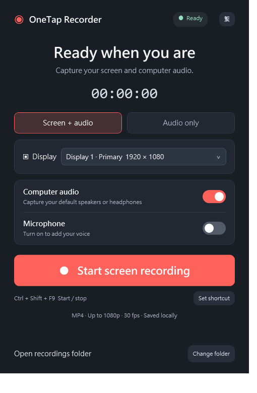

# OneTap Recorder

[繁體中文](README.zh-Hant.md)

A small, straightforward Windows app for recording your screen and computer audio, or audio alone. One button starts and stops a recording.

[Download the Windows x64 release](https://github.com/HKmario852/OneTapRecorder/releases)



## Features

- Screen + audio: choose a display and save an MP4, up to 1080p at 30 fps.
- Audio only: save a stereo 48 kHz, 16-bit WAV with no video capture.
- Computer audio and optional microphone, individually selectable.
- Custom global shortcut: a single key such as F8, or a combination such as Ctrl + Shift + R.
- Close the window to keep running in the system tray. Recording continues.
- Right-click the tray icon to open, start/stop, open the recording folder, or exit. Exit finishes saving first.
- English and Traditional Chinese UI, including tray menus and shortcut settings. Use the EN / 繁 button to switch.
- Preferences are remembered. Launching again brings the existing background instance forward.
- Local files only. No account, uploads, telemetry, background network polling, or automatic startup.

## Get started

1. Exit any older version. Download the Windows x64 ZIP from Releases and extract the entire folder.
2. Run `OneTapRecorder.exe`. Keep its supporting files beside it.
3. Select **Screen + audio** or **Audio only**, choose audio sources, then click the large record button.
4. Click again or use your shortcut to stop and save. Default shortcut: **Ctrl + Shift + F9**.
5. Files go to `Videos\OneTap Recordings` by default. Use **Change folder** to select another location.

The × button hides the app; it does not stop a recording or quit. Find its icon in the Windows system tray or the hidden-icons (^) area. Double-click to open, or right-click **Exit** to fully quit.

## Background resource use

v0.4 stops the UI timer completely while hidden/minimized and updates it once per second while visible. The tray tooltip updates on state changes instead of continuously. Audio writes are batched every 100 ms instead of every 20 ms, with the same sample rate and sample format. Video initialization is deferred until a screen recording is requested. Audio buffers are bounded.

On one development PC, a 15-second sample of hidden audio recording decreased from 1.77% to 0.94% of one CPU core; hidden UI timer callbacks decreased from 60 to 0. Private memory while idle remained about 102 MiB. These short measurements include test overhead and are not a universal performance guarantee or a claim of zero resource use. Recording still requires audio capture/encoding and disk writes. See [validation and measurements](docs/VALIDATION.md).

## Requirements and limitations

- Windows 10/11, x64. The download includes the .NET runtime.
- Screen recording also requires the [Microsoft Visual C++ x64 Redistributable](https://aka.ms/vs/17/release/vc_redist.x64.exe). Windows N/KN may need the Media Feature Pack.
- This build is unsigned.
- Audio uses the Windows default input/output devices chosen when recording starts. Restart the recording after changing devices.
- WAV takes roughly 690 MB per hour and stops near the 4 GB file limit. Both audio sources are mixed at half volume each to reduce clipping.
- F12 and Windows-key shortcuts are unavailable. Shortcuts used by another app cannot be claimed; the old shortcut is kept on conflict.
- Microphone/mixed-source listening quality, long recordings, other PCs, protected content, exclusive-fullscreen games, and shortcuts in elevated apps have not been comprehensively tested.

## Build

Install the .NET 9 SDK, then run from the repository root:

```powershell
./scripts/Build.ps1 -OutputDirectory ./artifacts/OneTapRecorder
```

The script publishes a self-contained x64 app and includes usage/dependency license files. See [diagnostics](docs/VALIDATION.md) before running capture tests; some tests record your actual display/audio.

## Third-party notices

Uses [ScreenRecorderLib 7.0.1](https://github.com/sskodje/ScreenRecorderLib) and [NAudio.Wasapi 2.4.0](https://github.com/naudio/NAudio), both with MIT license notices in `licenses/`. Those notices apply to the corresponding dependencies. No project-wide open-source license is granted for the application source at this time.
